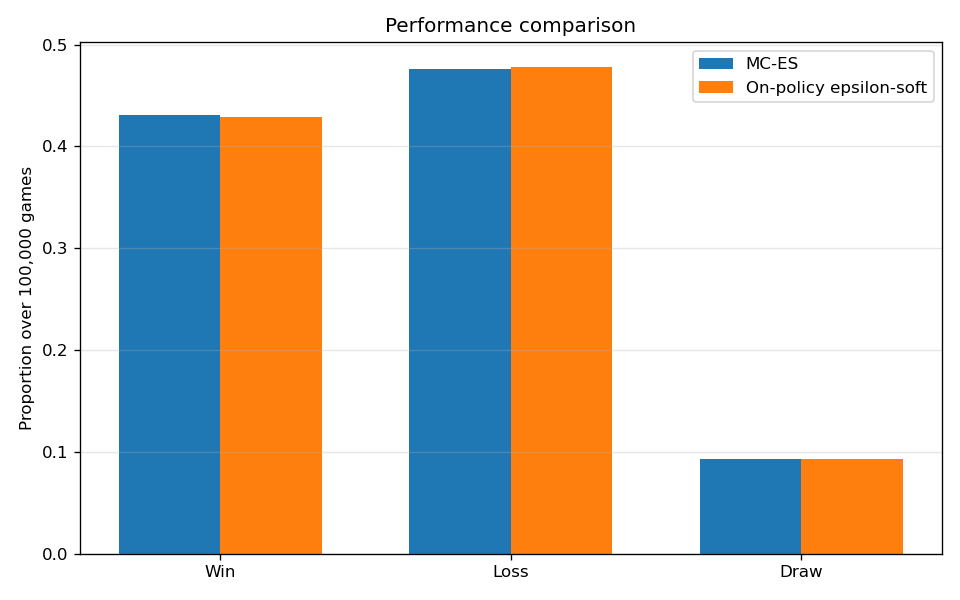
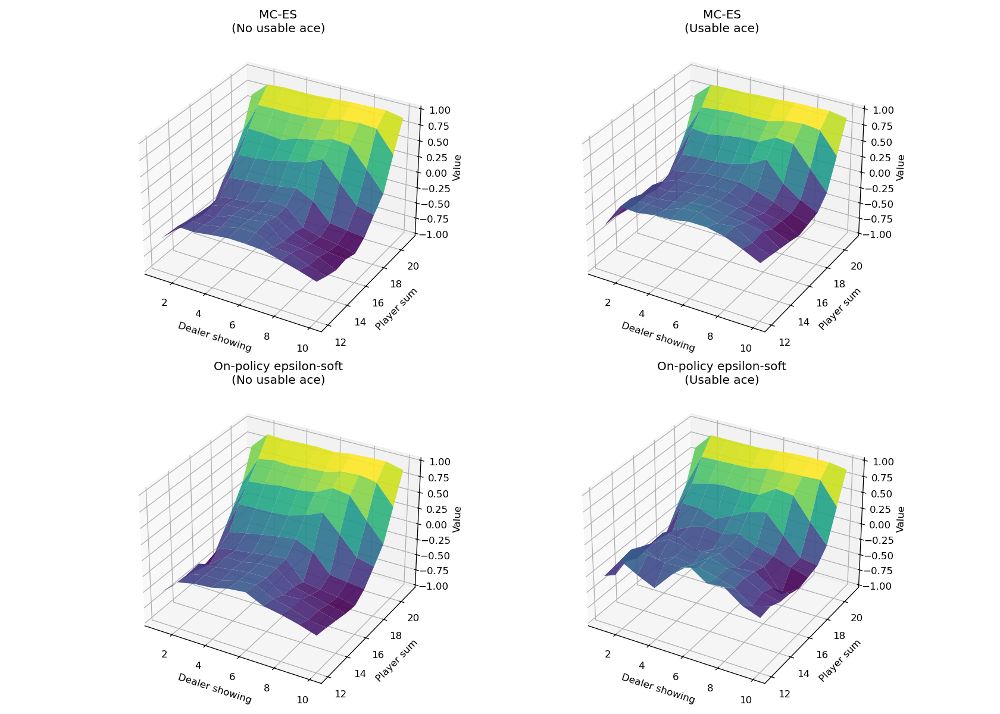
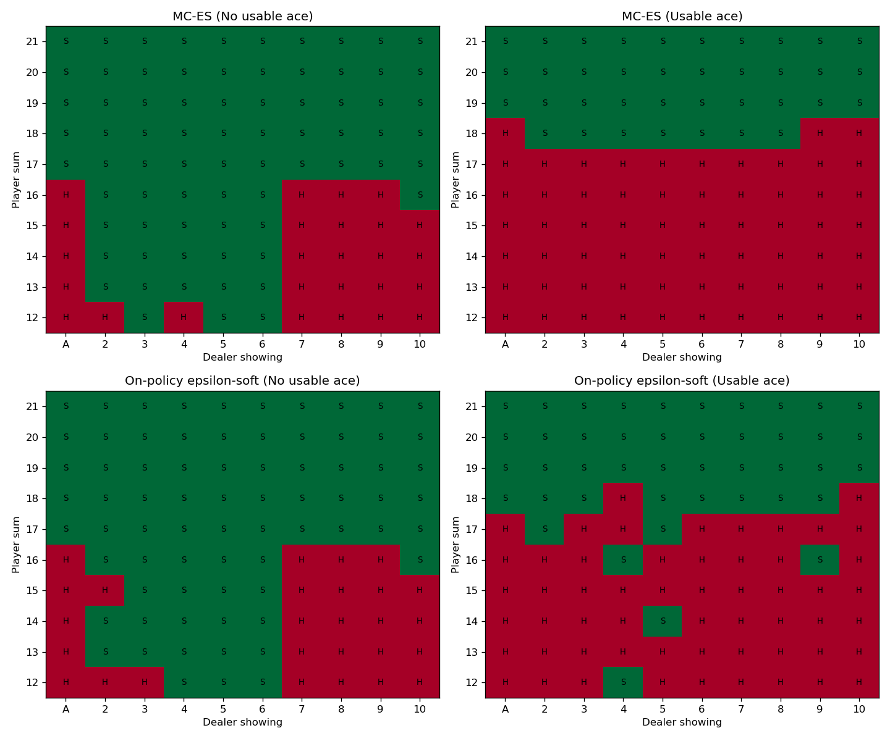
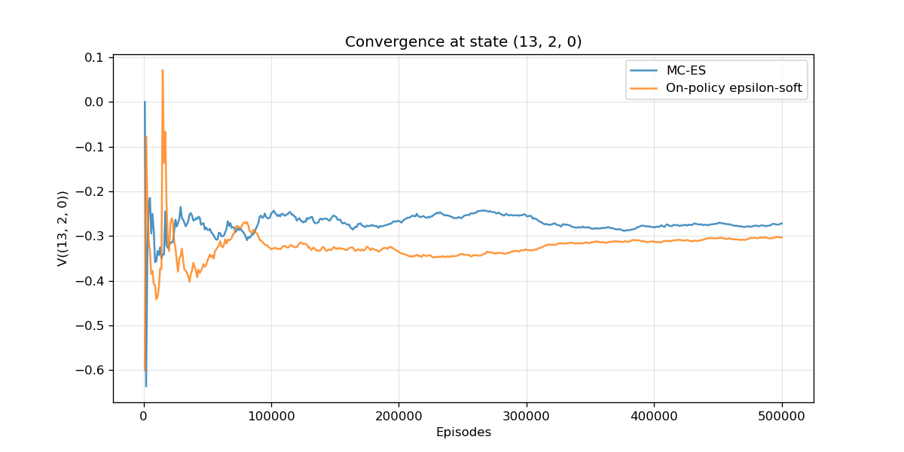
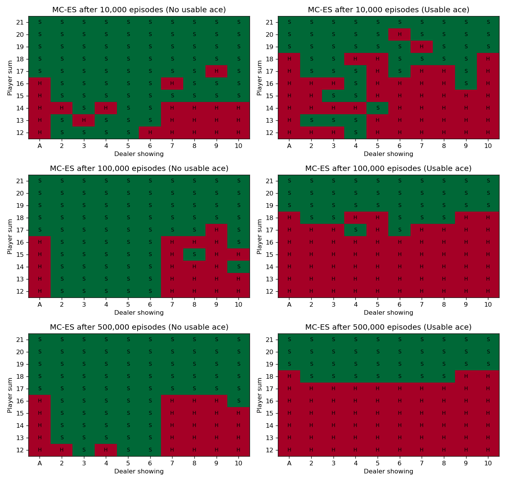

# Blackjack with Monte Carlo Control

A from-scratch reinforcement learning project: I built Sutton and Barto's Blackjack environment and trained an agent with two Monte Carlo control methods, then compared how they learn and how well they play. Built as a university project.

**Result:** both methods reach about 43% wins over 100,000 evaluation games (43.1% and 42.9%), which is the known optimum for this simplified variant. The learned strategy matches the basic-strategy patterns experienced players use.

## What's in it

- **Environment:** infinite deck (drawn with replacement), dealer stands on 17, no doubling or splitting. State is `(player_sum, dealer_showing, usable_ace)`, so 200 states. The only reward is at the end of the hand (+1, 0 or -1)
- **MC with Exploring Starts:** each episode begins from a random state-action pair, then plays greedily
- **On-policy first-visit MC, epsilon-soft:** natural deals with epsilon = 0.1 for exploration
- Both use first-visit returns and an incremental mean update, `Q <- Q + (G - Q) / N`, with gamma = 1. Both visited 200 of 200 states over 500,000 episodes

## Results

| Method | Win | Loss | Draw |
|---|---|---|---|
| MC-ES | 43.1% | 47.6% | 9.3% |
| On-policy epsilon-soft | 42.9% | 47.8% | 9.3% |



**Value function and policy.** Values plateau near +1 at sums of 20 and 21 and drop sharply around 17. With the dealer showing 4 to 6 the agent sticks early, and against 7 or higher it hits. With a usable ace it plays more aggressively.




**Convergence.** I tracked V(13, 2, 0) across training. Both methods are noisy for the first few thousand episodes and settle by around 100k. MC-ES ends at -0.272 and epsilon-soft at -0.303. The gap is the "exploration tax": epsilon-soft learns the value of a policy that is 10% random.




## Takeaways

- The policy at 100k episodes was already close to the 500k one. The extra training mostly cleans up rare states, which shows how sample-inefficient Monte Carlo is
- MC-ES covers rare states better but can't be used outside a simulator. Epsilon-soft is the realistic choice, at a cost of about 0.2 percentage points
- Next steps: TD methods such as Q-learning (far fewer samples), a decaying epsilon, and adding doubling and splitting

## Run it

```
pip install -r requirements.txt
jupyter notebook blackjack_MC.ipynb
```
